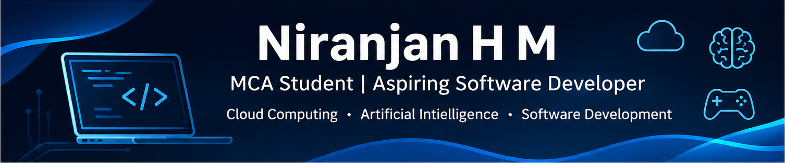

  

# Hi, I'm Niranjan H M 👋

### MCA Student | Aspiring Cloud Engineer | Software Developer | AI Enthusiast

I'm an MCA student at **R V University** interested in Cloud Computing, Software Development, Artificial Intelligence, and building practical technology solutions.

I enjoy turning ideas into working projects, exploring new technologies, and continuously improving my technical skills.

## 👨‍💻 About Me

- 🎓 Pursuing MCA at R V University (2026–2028)
- ☁️ Interested in AWS and Cloud Computing
- 💻 Building applications using Kotlin, C++, and Python
- 🤖 Exploring Artificial Intelligence and Machine Learning
- 💼 Former AWS Cloud Computing Intern at SkillDzire
- 🤝 Student Placement Coordinator at R V University
- 🌱 Always learning and building new projects

## 🛠️ Technical Skills

| Category | Technologies |
|---|---|
| Programming | Python, C++, Kotlin, Java, SQL |
| Cloud | AWS EC2, S3, IAM, VPC, CloudWatch |
| Android Development | Kotlin, Jetpack Compose, Room |
| AI & Machine Learning | NumPy, Pandas, PyTorch |
| Build Tools | CMake, Gradle |
| Databases | MySQL, Room |
| Developer Tools | Git, GitHub, Visual Studio, VS Code |
## 🛠️ Languages & Tools

## 🚀 Featured Projects

### 1. AI Service Guide
An Android application that helps citizens understand government services, required documents, and application procedures using AI-assisted guidance and a local service database.

**Tech Stack:** Kotlin, Jetpack Compose, Room, Gemini API

[View Repository](https://github.com/niranjanhm21/AIServiceGuide)

### 2. CodeMaze — Adaptive C++ Learning Maze
A 2D educational game where players explore mazes and solve C++ programming challenges. It includes performance tracking and adaptive question selection based on learning progress.

**Tech Stack:** C++20, SFML 3, CMake, MSVC

[View Repository](https://github.com/niranjanhm21/CodeMaze)

## 📜 Certifications & Learning

- AWS Cloud Fundamentals
- Python Programming
- Cyber Security — Simplilearn
- AI for Sustainability — IBM SkillsBuild
- AI-related learning — Infosys Springboard

## 🎯 Current Focus

- Strengthening AWS and Cloud Computing fundamentals
- Building practical software development projects
- Improving Python and problem-solving skills
- Exploring AI and Machine Learning applications
- Learning software architecture and development best practices

## 🤝 Connect With Me

- **LinkedIn:** [Connect with me](https://www.linkedin.com/in/niranjan-h-m-a52a49389/)
- **GitHub:** [niranjanhm21](https://github.com/niranjanhm21)

---

⭐ *Always learning. Always building. Always improving.*
